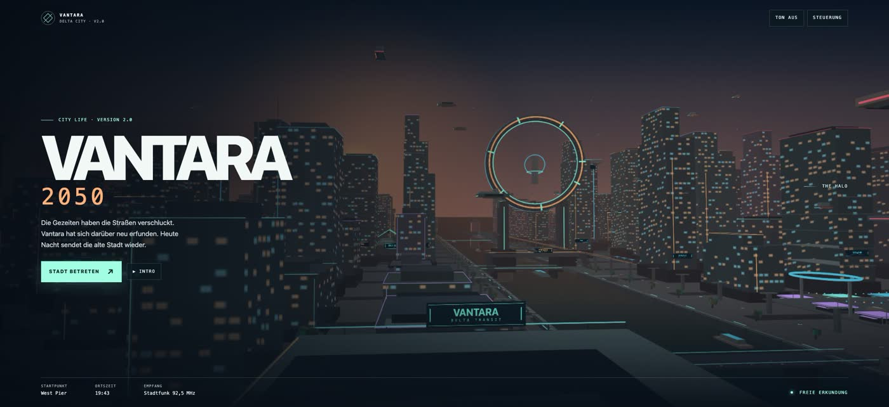
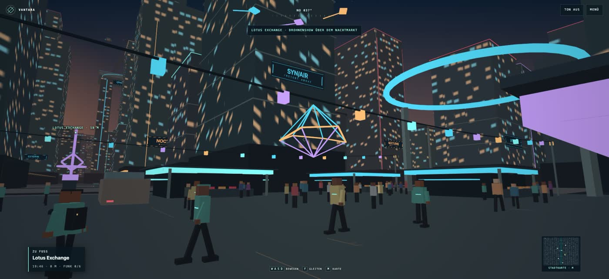
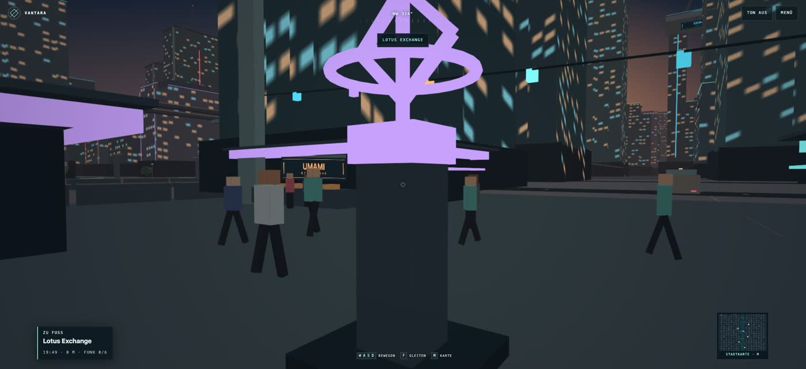

# VANTARA 2050 · City Life 2.0

**[Play in your browser](https://arnefranz-del.github.io/vantara-2050/)** · [Release and offline HTML](https://github.com/arnefranz-del/vantara-2050/releases/tag/v2.0.0) · [21-second video tour](https://github.com/arnefranz-del/vantara-2050/releases/download/v2.0.0/VANTARA-City-Life.mp4)

The tide took the streets. Vantara built over them. Tonight, the old city is broadcasting again.

Walk out onto West Pier, follow the elevated railway to Lotus Exchange, or glide between the towers. Six radio relays carry stories from the people who stayed. The game and its interface are in German.

## What's moving in 2.0

- 178 residents walk circuits, browse market stalls, and gather on the riverfront and rooftops.
- Cars and shuttles share the streets. Couriers, air taxis and freighters cross the delta on different routes while ferries leave wakes below.
- At Lotus Exchange, lanterns hang over the food stalls and a formation of 19 light drones performs above the square.
- Switch on **Ton** to hear the waterfront, market murmur, traffic and footsteps change as you move.
- The WebGL 2 renderer sharpens the final image. The Canvas renderer also draws the new people, vehicles and events and supports a higher maximum resolution.

## Play offline

Download **VANTARA-2050-v2.0.html** from the release and open it in your browser. The game generates its own models, textures, movement and audio. No installation or network connection is needed. Discovered radio relays are saved locally when browser storage is available.

| Control | Action |
| --- | --- |
| W A S D / mouse or drag | Move / look around |
| Shift / Space | Sprint / jump |
| F | Toggle glide |
| Space / C while gliding | Ascend / descend |
| E | Read a nearby radio relay |
| M | Open the map, set a waypoint or fast-travel |
| T | Cycle sunset, night and morning |
| P | Cue the drone show at Lotus Exchange |
| Esc | Release the mouse, skip the intro or close a panel |

For a quick visit, choose **Steuerung → Zur Drohnenshow** on the title screen. On touch devices, use the movement pad and swipe the view to turn.

